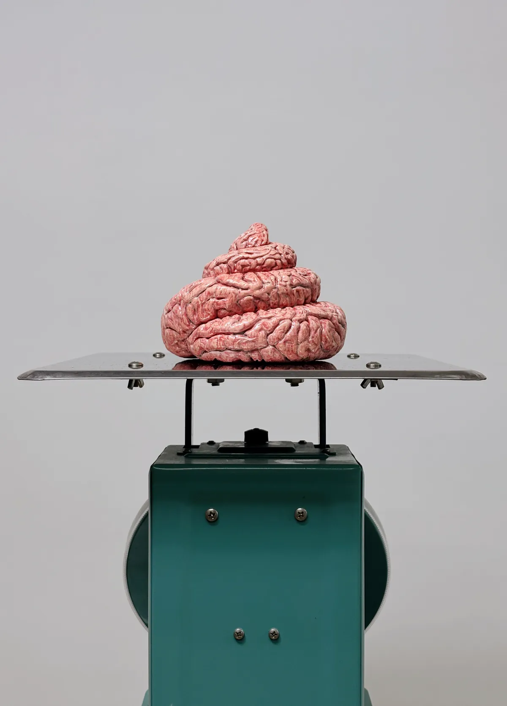
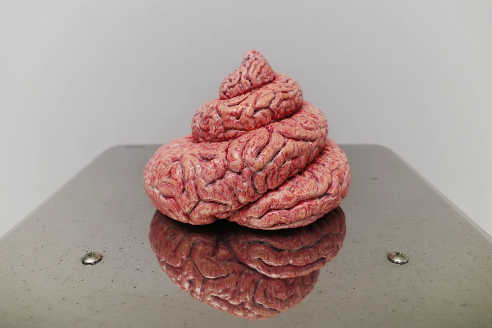
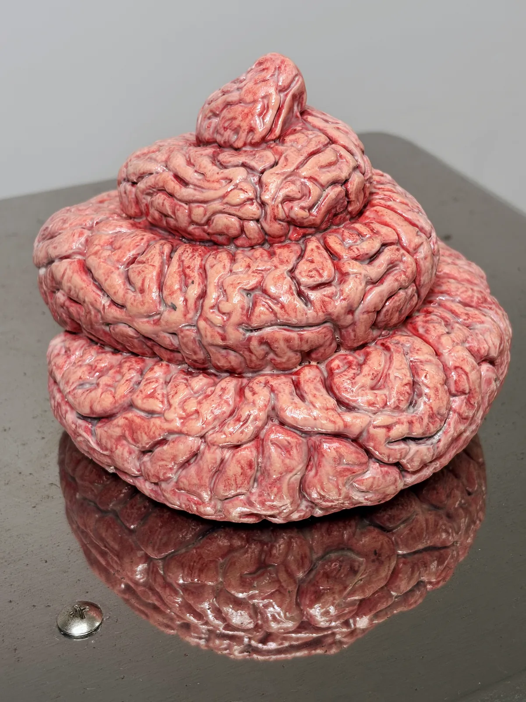
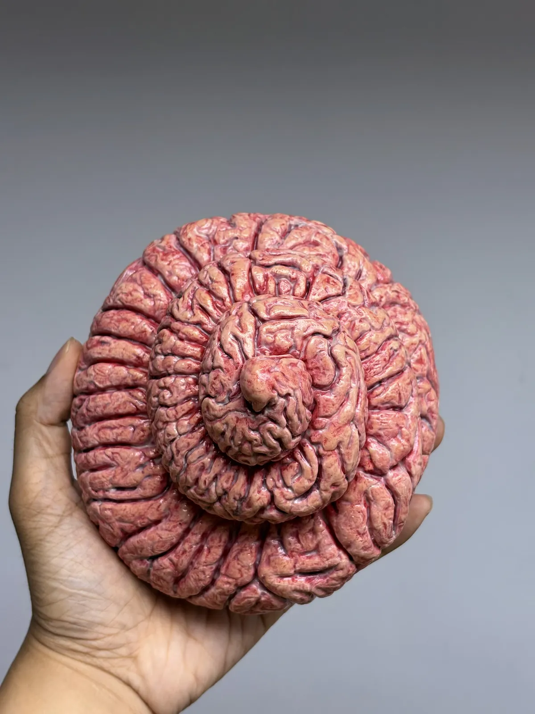

[HI](../../)  ||  [WORKS](../../works/)  ||  [BLOG](../../writings/)  ||  [TALKS](../../talks/)  ||  [PRESS](../../press/)

# Offload

Year: 2026  
Type: acrylic-painted PLA plastic and mechanical scale. Dimensions variable.
<!-- Published: 2026-10-20 -->

---

You are looking at a life-size human brain, coiled into a comical 💩 shape. It sits on the steel platter of a teal mechanical scale, ready to be sold by the kilo. Layered acrylic makes the 3D-printed plastic look fleshy and wet, as if the load was just dropped. It is repulsive and uncannily nonhuman. You should look away. Yet you lean in, and notice some gyri are so uniformly stacked they must be AI-generated, the unmistakable hallmark of algorithms that scrape, digest, and excrete slop across the internet.

From a low angle, the platter’s reflection flattens the pink coil back into an ordinary brain silhouette, the mythical organ of pristine intelligence, the one we like to think is still doing the work. 

Mine isn't, entirely. This piece originated in an AI chat where I tried to learn about organ projection and abjection, and to reflect on my career of building AI productivity tools. 

By using Nano Banana 2, Rodin Gen-2.5 and some corn-based filaments, I want to give physical form to the dread, skepticism, and lure of outsourcing our daily thinking to machines. Make a vulgar visual gag. And then ask: just wtf are we doing to our minds, and with them?

